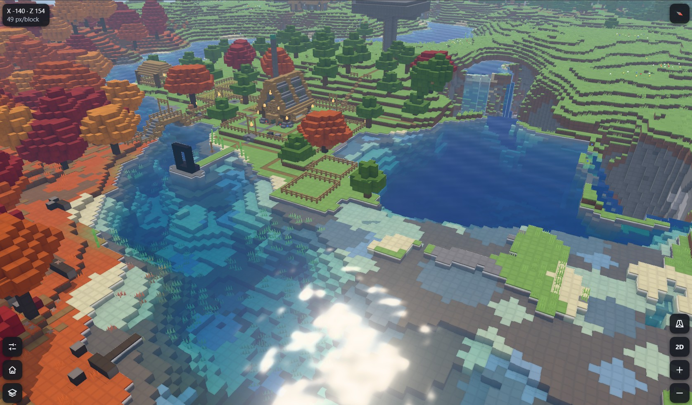
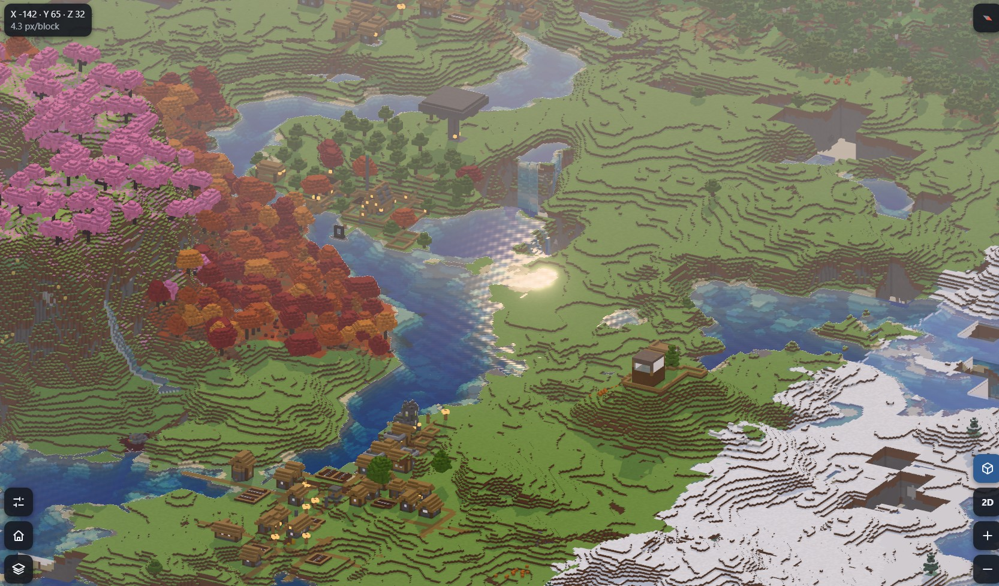
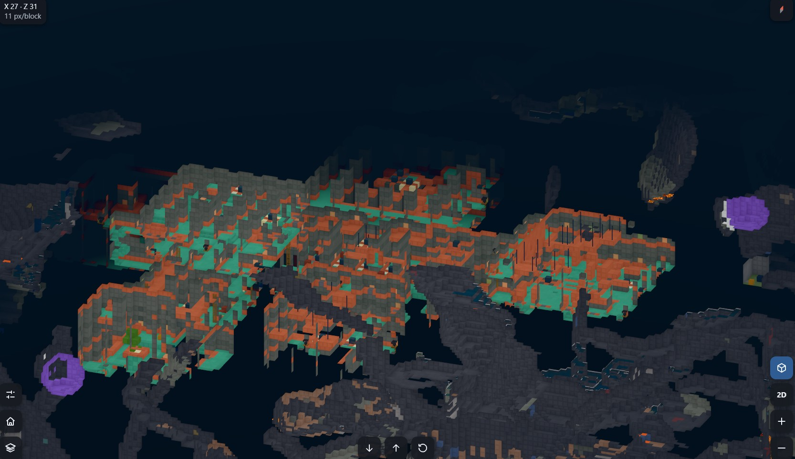
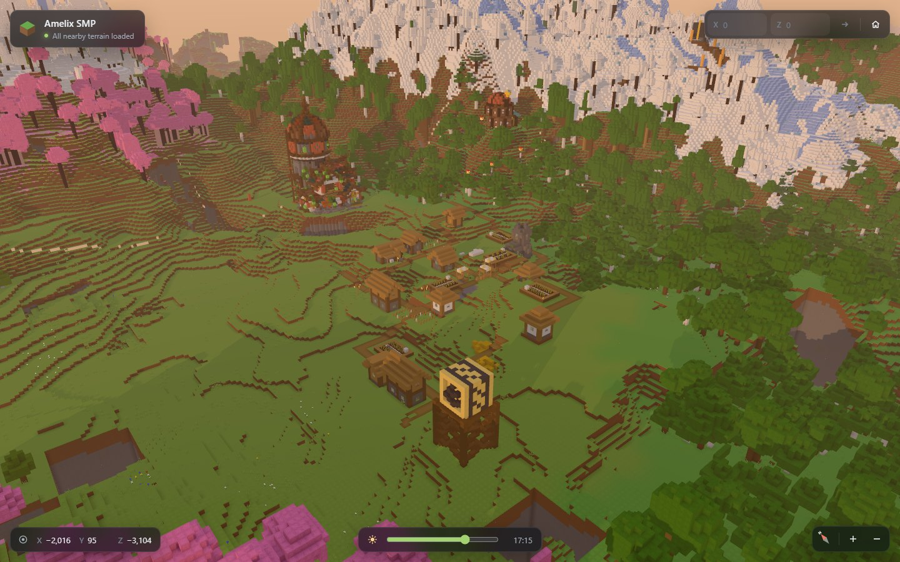
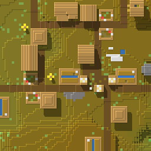

# Mapelix

Mapelix turns a Minecraft Bedrock world into a pre-rendered 2D map and a 3D world viewer, both in
TypeScript. The 3D view, isometric or perspective, opens from the map at the same place and scale
when you zoom in, and turns back into the map when you zoom out.

Mapelix is the bastard child of
[Mojang's Minecraft Creator Tools](https://github.com/Mojang/minecraft-creator-tools) and
[uNmINeD](https://unmined.net/). It takes Mojang's official tooling for reading worlds and combines
it with an almost-clean-room port reverse-engineered from a uNmINeD 0.20.1-dev binary, so the look of
uNmINeD maps becomes a low-level, programmatic TypeScript API with no native image or LevelDB
dependency and no call into the .NET uNmINeD CLI.

| 2D map                                                           | 3D view, perspective                                                                |
| ---------------------------------------------------------------- | ----------------------------------------------------------------------------------- |
|  |  |

## Quick start

Work on a copy of the world: Mapelix only reads it, but the game may change it while it runs.

1. **Install.** With [Mise](https://mise.jdx.dev/), which selects Node.js 24 and pnpm 11:

   ```sh
   mise install
   mise exec -- pnpm install
   mise exec -- pnpm exec turbo run build --filter=@mapelix/render-cli... --filter=@mapelix/demo...
   ```

2. **Render** the 2D map into an output folder:

   ```sh
   node apps/render-cli/dist/index.js --world /path/to/world --output /path/to/map \
     --dimension overworld,nether
   ```

3. **View** it. The demo is a full-screen map for phones and desktops. With
   `MAPELIX_WORLD_DIRECTORY`, zooming in past 5 CSS pixels per block turns the map into the 3D
   world at the same place and scale, and zooming out below 4 turns it back into the map:

   ```sh
   MAPELIX_TILES_DIRECTORY=/path/to/map \
   MAPELIX_WORLD_DIRECTORY=/path/to/world \
   PORT=3000 node apps/mapelix-demo/build/index.js
   ```

   Open `http://localhost:3000`, or the computer's address from a phone on the same network.
   Leave out `MAPELIX_WORLD_DIRECTORY` for the 2D map alone.

4. **Update** after the world changes: render again into the same folder with `--incremental`
   (only tiles whose chunks changed are drawn again) and `--surface-cache` (chunk surfaces are kept
   between runs, so redrawn tiles read less of the world). The open map picks up the new
   publication on the next page load.

   ```sh
   node apps/render-cli/dist/index.js --world /path/to/world --output /path/to/map \
     --dimension overworld,nether --incremental --surface-cache
   ```

## Features

### 2D map

- **Zooms −4..+2** by default: native tiles from 1 to 4 pixels per block, and transparent overview
  tiles down to 16 blocks per pixel, derived from native zoom zero
  ([overview contract](docs/2d-overviews.md)). Standard 256 × 256 XYZ PNG tiles.
- **Dimension profiles** for Overworld, Nether and End. The Nether is cut at Y 90 by default so
  its caverns show under the roof; `--top-y` sets another cut.
- **Classic look:** biome colors, elevation shading, water depth and transparency, contours and 3D
  shadows. Modern flat colors from a catalog shared with the 3D view are the default
  ([color catalog](docs/2d-block-colors.md)); `--appearance reference` keeps the previous palette,
  `--biome-blend-radius` smooths biome colors, `--shadows` changes or disables shadows.
- **Safe publication:** the CLI reads a snapshot, renders within worker, tile, byte, time and
  memory limits, and publishes a versioned JSON manifest atomically after a verified export.
- **Incremental updates:** `--incremental` redraws only tiles whose chunks, shadow halo or
  biome-blend window changed; `--surface-cache` keeps extracted chunk surfaces between runs.
- **Performance** on a small test world (Overworld, zooms −4..+2, 376 tiles, two workers): a full
  render takes about 15 s, an unchanged world 3.4 s, and an update after 20 changed chunks about
  7 s with the surface cache ([measurements](docs/2d-performance.md)).
- **Viewer:** one-finger or mouse drag with glide, pinch and wheel zoom around the fingers or the
  pointer, double-tap zoom, arrow and +/− keys, and the view kept in the address bar.

### 3D world

- **Streaming:** terrain near the camera is drawn block by block, simpler levels of detail stream
  out to the horizon. Drawn with three.js on WebGPU, with a WebGL 2 fallback.
- **Dimensions:** Overworld, Nether (with an adjustable ceiling cut) and End; changing dimension in
  3D reloads the world at the same place.
- **Caves:** 16 or 32-block slices, including enclosed negative-Y caverns, with automatic depth
  that follows the camera and a selectable exploration area
  ([underground rendering](docs/underground-rendering.md),
  [cave navigation](docs/cave-navigation.md)).
- **Discoveries:** ores (exposed or fully buried), spawners, containers, vaults, amethyst, sculk,
  portals and rails, with filters, a list, a detail card and a flight to each one, shown only
  when switched on ([discovery labels](docs/discovery-labels.md),
  [discovery navigation](docs/discovery-navigation.md)).
- **Sky:** clouds, rain, thunderstorm and time of day on the Overworld surface
  ([clouds and weather](docs/clouds-weather.md)).
- **Projection:** isometric or perspective; the switch from the map starts isometric, looking
  straight down.
- **Controls:** one set of buttons for 2D and 3D that keep their place across the switch, sized for
  touch (48 px), light and dark, from `@mapelix/viewer/controls`. Touch: drag to move, two fingers
  to turn and tilt, pinch to zoom. Mouse: drag, right button to turn, wheel. Keys: WASD or arrows,
  Q/E, R/F, +/−, and Space/C up and down in caves. Compass, return home, go to coordinates.

### Markers

- **Host markers** on the map and in 3D (isometric and perspective) at the same place:
  `viewer.markers.set / upsert / update / remove / clear`, with an icon (a few characters or an
  http(s) image), a color, a label, a group to show or hide, a priority and free host data.
  Mapelix stores nothing; a tap or a click reports `onClick` with the marker.
- **Readable on phones:** labels go where they overlap no marker, label or control, and markers
  closer than about 48 px group into a count bubble that zooms in when tapped. A drag that starts
  on a marker still moves the view.
- **Light:** only the markers and groups in view exist in the page; 1,000 markers cost about 1 ms
  per frame on a phone-class CPU.

### Gallery

| Isometric                                                                 | Thunderstorm at dusk                                                                    |
| ------------------------------------------------------------------------- | --------------------------------------------------------------------------------------- |
|    |          |
| **Caves**                                                                 | **Discoveries**                                                                         |
|          |  |
| **Nether**                                                                | **Village, golden hour**                                                                |
|  |    |

## Packages and apps

| Path                                                                             | Role                                                                                                                                                                                                       |
| -------------------------------------------------------------------------------- | ---------------------------------------------------------------------------------------------------------------------------------------------------------------------------------------------------------- |
| [`packages/mapelix-core`](packages/mapelix-core/README.md)                       | 2D dimension profiles, the shared block-color catalog and the batch export API (`@mapelix/core/node/batch`) used by the CLI.                                                                               |
| [`packages/mapelix-prototype`](packages/mapelix-prototype/README.md)             | Reference 2D renderer: reads Bedrock LevelDB worlds and renders uNmINeD-style tiles. Holds the visual regression suite.                                                                                    |
| [`packages/mapelix-scene-prototype`](packages/mapelix-scene-prototype/README.md) | Builds 3D scene regions from a world in worker threads: meshes, levels of detail, cave slices, discoveries.                                                                                                |
| `packages/mapelix-viewer`                                                        | Browser viewer: the 2D tile map, `MapelixViewer` (one API for the map, the 3D view and the switch between them), the marker layer, the optional DOM controls (`./controls`) and the 3D engine (`./three`). |
| [`apps/render-cli`](apps/render-cli/README.md)                                   | `mapelix-render`: exports and updates the 2D tiles and their manifest.                                                                                                                                     |
| [`apps/mapelix-demo`](apps/mapelix-demo/README.md)                               | Full-screen SvelteKit host for phones and desktops: serves an export and, optionally, the 3D world.                                                                                                        |
| [`apps/prototype-viewer`](apps/prototype-viewer/README.md)                       | Leaflet map that renders tiles on demand from the world, with no render step: handy to look at a world once, slower to browse.                                                                             |
| [`apps/prototype-viewer-3d`](apps/prototype-viewer-3d/README.md)                 | Full 3D explorer with its developer panel (F3) and the automatic-perspective demo.                                                                                                                         |
| `apps/prototype-visual-check`                                                    | Browser smoke test that renders the committed fixture world with the reference renderer.                                                                                                                   |

All packages are private and their APIs can still change.

## Known limits

- **Bedrock only**, read from a folder. Updates are not live: render again (with `--incremental`)
  after the world changes. The 2D renderer runs in Node.js, not in the browser.
- **The 3D view needs a server** that reads the world; there is no static 3D export.
- **2D:** no textures and no isometric images. Bed colors stored in block entities are not read yet.
- **3D:** coarse levels of detail can close narrow caves; the Nether atmosphere does not change with
  biomes; resource packs, custom dimensions and entities are not drawn, and unknown blocks fall
  back to a plain solid.
- **Isometric 3D:** exploration-area handles still pick as in perspective, and discovery markers
  behind the camera can show.
- **Discoveries** are limited by a search budget around the view, and exposure is uncertain next to
  unsaved chunks.
- Two 3D browser tests sometimes time out in a full run while terrain loads, and pass alone.

## Similarity to uNmINeD

The committed visual suite compares renders of the reference renderer (`@mapelix/prototype`) with
lossless uNmINeD reference renders across ten scenes from a real world. It checks structure, block
color, shadows and tile alignment. The production default uses the modern color catalog;
`--appearance reference` selects the measured look.

| Signal                     |               Baseline |
| -------------------------- | ---------------------: |
| Overall similarity         |             **97.12%** |
| Exact structural-edge F1   |                 94.52% |
| One-pixel-tolerant edge F1 |                 97.07% |
| Shadow-mask F1             |                 97.47% |
| Block-color similarity     |                 99.37% |
| Native-tile alignment      | Exact in all 10 scenes |

| Mapelix                                                                                                                       | uNmINeD                                                                                                                     |
| ----------------------------------------------------------------------------------------------------------------------------- | --------------------------------------------------------------------------------------------------------------------------- |
|  |  |

Run it with `mise exec -- pnpm test:visual`. See the
[visual regression suite](packages/mapelix-prototype/test/visual-regression/README.md) for the
input format and the reports, and [`REWRITE.md`](REWRITE.md) for the per-scene scores.

## Development

```sh
mise install
mise exec -- pnpm install
mise exec -- pnpm quality
mise exec -- pnpm test:visual
```

If Mise asks you to trust the project configuration, review `mise.toml` and run `mise trust`. If
Mise is already activated in your shell, you can omit `mise exec --`. The real-world tests use the
system `unzip` command to expand the committed `.mcworld` fixture into a temporary directory.

## Documentation

- 2D: [CLI options and manifest](apps/render-cli/README.md),
  [overviews](docs/2d-overviews.md), [colors](docs/2d-block-colors.md),
  [performance](docs/2d-performance.md).
- 3D: [3D explorer](apps/prototype-viewer-3d/README.md),
  [dimensions](docs/native-dimensions.md), [underground rendering](docs/underground-rendering.md),
  [underground exploration](docs/underground-exploration.md),
  [cave navigation](docs/cave-navigation.md), [clouds and weather](docs/clouds-weather.md),
  [block models and lava](docs/block-models-and-lava.md), [block colors](docs/block-colors.md).
- Discoveries: [labels](docs/discovery-labels.md), [navigation](docs/discovery-navigation.md).
- Hosting: [demo](apps/mapelix-demo/README.md), [on-demand viewer](apps/prototype-viewer/README.md).
- Background: [`OPTIMIZATIONS.md`](OPTIMIZATIONS.md) (speed, memory and accuracy experiments),
  [`REWRITE.md`](REWRITE.md) (production rewrite ledger and open questions),
  [`docs/research`](docs/research) (clean-room notes on map rendering and uNmINeD behavior).
