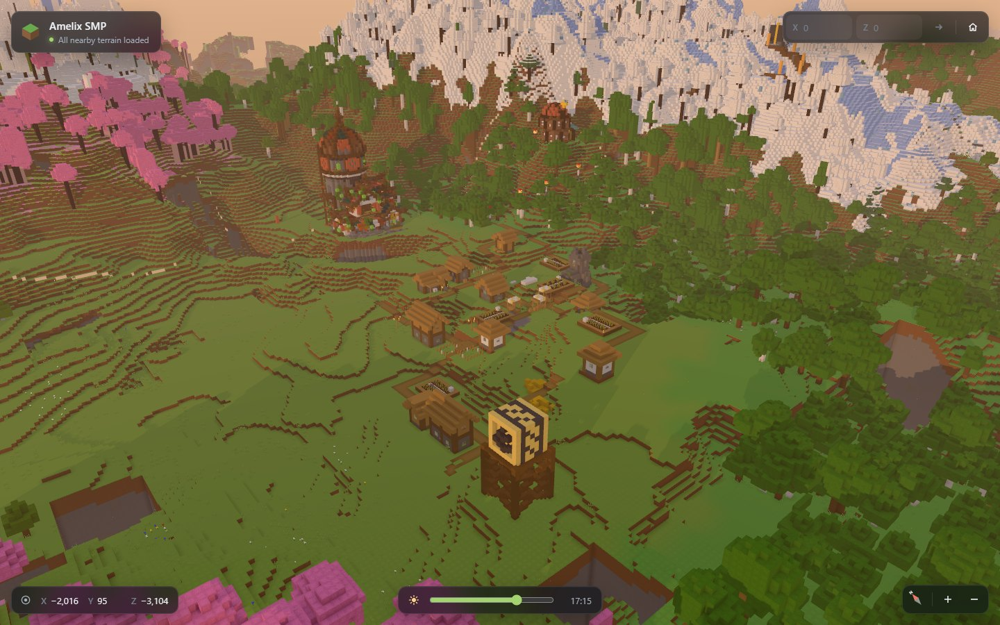

# Mapelix 3D Viewer

> Prototype app: explore a local Bedrock world in 3D in the browser.



The viewer streams the world from a local server and draws it with three.js. It uses WebGPU
when the browser supports it and falls back to WebGL 2.

```sh
MAPELIX_WORLD_DIRECTORY=/path/to/world \
pnpm --filter @mapelix/prototype-viewer-3d dev
```

Open `http://127.0.0.1:5173`. The camera starts at the world spawn.

## Settings

| Variable                  | Default                                                   | Use                                                                        |
| ------------------------- | --------------------------------------------------------- | -------------------------------------------------------------------------- |
| `MAPELIX_WORLD_DIRECTORY` | `.local/worlds/Amelix-8-12-26/Amelix SMP` in the monorepo | The extracted Bedrock world to show.                                       |
| `MAPELIX_CACHE_DIRECTORY` | `/tmp/mapelix-scene-cache`                                | Where built regions are kept.                                              |
| `MAPELIX_SCENE_WORKERS`   | `1`                                                       | Worker threads per visited dimension; shared by Surface and Caves.         |
| `MAPELIX_CAVE_MEMORY_MIB` | `16`                                                      | Separate local encoded cave cache; cave regions are not persisted to disk. |

The server builds each region the first time a browser asks for it. Surface results are kept
on disk; cave results use their own bounded memory cache and are not persisted locally.
The cache key includes the world's table files, so a changed world builds fresh regions. Each
region response has `x-mapelix-cache: memory`, `disk`, or `build` and a `server-timing` duration.

Dimension and mesh ceiling are included in memory, disk and HTTP cache identities. Switching
dimensions replaces the terrain streamer, aborts previous requests and retains the renderer.
An unvisited dimension displays empty space until the copied world contains chunks there.

## Controls

- Select Overworld, Nether or The End in the dimension menu. The Nether roof control hides
  terrain at and above the selected Y, in 16-block steps, before any mesh or LOD is generated.
- Select **Caves** in the View menu to explore a vertical slice, including sealed negative-Y
  caverns. Choose 16/32 blocks and release the depth slider to rebuild. Cave streaming uses
  LOD 0/1, a maximum 128-block radius, fixed exploration lighting and bounded resources.
  **Space / C** or the held **Ascend / Descend** buttons move vertically.
  Space belongs to the view/page only; focused buttons and form controls retain it.
  Shift has no camera action. Page Up/Down remain aliases.
  **Follow depth automatically** moves the slice in 16-block steps as you approach its edge;
  turn it off to inspect a fixed slice. This preference survives reloads and shared links.
  **Recover view** restores an overview of the current slice without changing X/Z.
  A slice containing only solid rock can be empty; change depth or move to another area.
- Open **Exploration area** to select the underground beneath a location. Set X/Z
  bounds or drag the 3D Move/Resize handles. Moving Y commits a new slice when released.
- Open **Discoveries** to enable nearby source indexing and markers. Filter by category,
  ore type and exposure, including fully buried resources. **Search all heights** also
  finds blocks outside the current slice. In Surface mode, leave it off for objects
  verified on the exterior surface; enable it to include covered objects as well.
  Exact terrain must be loaded to certify visibility; zoom in if needed.
  Containers in rooms beneath roofs remain discoverable when their faces exist in the
  detailed Surface mesh. Mouse hover or keyboard focus shows an immediate marker label.
  Clicking a verified surface object stays on Surface; any other object opens its cave slice.
  From Caves, navigation retains Caves and opens another slice when needed.
  Framing preserves orientation, approaches moderately and opens one details card.
  A blank click, pan or zoom dismisses the card; orbiting retains it.
  Filters persist in shared links and browser preferences. Search/display/cache limits
  are bounded and shown when reached; no container contents are exposed.
- Nether starts at the Overworld spawn divided by eight; End starts at X 100, Z 0. These
  are navigation entry points, not stored portal or player positions.
- Drag to move. Right-drag to turn and tilt. Scroll to zoom toward the point under the cursor.
- W, A, S, and D move. Q and E turn. R and F zoom.
- Enter X and Z coordinates to fly there. The house button returns to spawn.
- The compass turns the view to face north. The cube button next to it switches between the
  perspective and an isometric (orthographic) view with a short animation. The isometric view
  keeps the scale of the plane through the focus and hides clouds. Rain covers the whole
  visible ground there, with the same density on screen at every zoom.
- The Overworld slider sets the time of day. Nether and End use fixed lighting and atmosphere.
- Overworld Surface also offers **Clouds**, **Rain** and **Thunderstorm** checkboxes.
  Clouds start on; cosmetic weather starts off. These visual preferences survive reloads.
  Rain adapts its particle budget when rendering slows down. Caves, Nether and End hide
  both effects. See [clouds and weather](../../docs/clouds-weather.md) for host options,
  rendering limits and the embed 3 contract.
- F3 shows the frame rate, the backend, and streaming statistics. It also has switches for the
  edge fog and two experimental options: zooming out to 20,000 blocks and a custom render
  distance from 2,000 to 100,000 blocks.

The camera turns around the surface in the middle of the view. It can go anywhere with open
air, such as under bridges and between the floors of a build. It slides along surfaces it runs
into and climbs over walls and steps. Caves instead allow movement through rock and retain
the orbit pivot, so narrow passages cannot trap the camera.

The address bar keeps the current view, so a link opens the same place. It accepts `x`, `y`,
`z`, `distance`, `heading`, and `pitch` in blocks and degrees, and `hour` from 0 to 24. A link
without `y` looks at the highest block at `x` and `z`. `projection=iso` opens the isometric view.
`demo=projection` adds a panel that shows the scale in pixels per block (2D map zoom `z` is
`2^z` pixels per block), presets for scale and tilt, and two optional rules that show
perspective inside the isometric view past a zoom or below a tilt.

Links also retain `dimension` (`overworld`, `nether`, `the-end`) and `ceilingY`. For example,
`?dimension=nether&ceilingY=80&x=0&z=0` opens a Nether cut at Y 80.

Cave links retain `mode=caves`, `minY` and exclusive `maxY`, for example
`?mode=caves&minY=-64&maxY=-32&x=-61&y=-48&z=25&distance=80&pitch=60`.
The `ceilingY` alias remains accepted. See the
[Milestone 1 notes](../../docs/underground-rendering.md) for the engine contract,
memory lifecycle and responsibilities of production adapters.

Selection and discovery interfaces, cache budgets and the API/embed 3 handoff are
documented in [Milestones 2–4](../../docs/underground-exploration.md). Local discovery
indexes use a separate 4 MiB memory cache (`MAPELIX_DISCOVERY_MEMORY_MIB`), with no
disk writes. The terrain URL base and suffix remain configurable independently
of `discoveryBase`/`discoverySuffix` in embedded consumers.
Optional automatic-depth loading, mobile methods and the backwards-compatible embed 3
handoff are described in [cave navigation](../../docs/cave-navigation.md).
Discovery framing, the Surface proximity rule and optional translated/host-owned
details are described in [discovery navigation](../../docs/discovery-navigation.md).
Immediate labels and the optional host label formatter are described in
[discovery labels](../../docs/discovery-labels.md).

### Projection options

Hosts choose the projection with the `projection` option (`"perspective"`, the default, or
`"isometric"`) or `setProjection(mode, animate = true)`. Automatic perspective is off by
default. A host can turn it on with the `autoPerspective` option or
`setAutoPerspective(rules)`, and `undefined` turns it off again. Each rule is optional:

| Rule | Unit | Effect |
| --- | --- | --- |
| `abovePixelsPerBlock` | CSS pixels per block | Show perspective while zoomed in past this scale |
| `belowPitch` | radians | Show perspective while the camera looks down by less than this |

The rules only change what an isometric choice shows; a perspective choice stays
perspective. A switch back needs an 8 % margin, so the view does not flicker at a threshold.
`snapshot().projection` reports the chosen and shown projection, the blend and the scale.

## Validation

From the monorepo root, run `pnpm turbo run test:unit --filter=@mapelix/prototype-viewer-3d`.
Run `pnpm turbo run test:e2e --filter=@mapelix/prototype-viewer-3d` for browser/API tests with
a generated disposable database. They exercise normal GPU selection and forced WebGL fallback.
Set `MAPELIX_TEST_BROWSER=chrome` to use installed Chrome instead of Playwright Chromium.
Set `MAPELIX_E2E_WORLD_DIRECTORY` to a disposable extracted world snapshot to validate real
terrain; test setup does not change that directory. Test caches and screenshots stay in `.local`
and `test-results` respectively. Build the scene package before invoking the app test command
directly; the root Turborepo task builds its dependencies automatically.

See [milestone notes](../../docs/native-dimensions.md) for the API contract and measurements.

## How it draws the world

Terrain near the camera is drawn block by block. Farther away, the viewer draws cubic voxels
that start one block wide and grow to 16 blocks wide at the horizon, so builds, bridges, and
tree crowns keep their shape far away. Like [Voxy](https://github.com/MCRcortex/voxy), it picks
each region's voxel size by its size on screen: a region switches to finer voxels before its
voxels grow larger than 2.2 pixels. Larger windows and high-density screens get more detail. The
viewer asks for the most useful regions first and keeps a coarse region on screen until all of
its finer replacements arrive. Regions dissolve in and out as they change.

Lighting follows the time of day. The sun casts shadows from terrain at every level, up to 2,048
blocks from the point the camera looks at. Water refracts and reflects the sky, and glowing
blocks bloom at night. Haze thickens with distance, and terrain fades into the sky before the
edge of the loaded area.

In Chrome with an RTX 2070 at 1440×900, the viewer draws 170 to 320 frames per second with the
frame limit off, from 400 to 2,400 blocks away.
